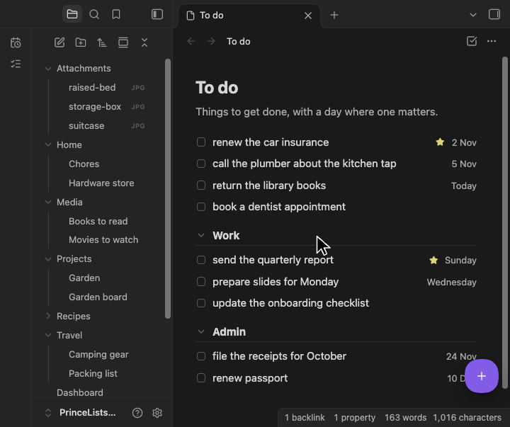
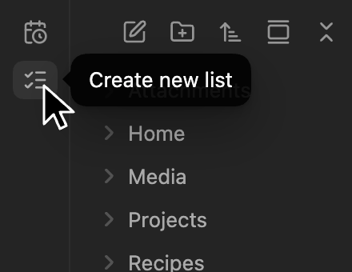
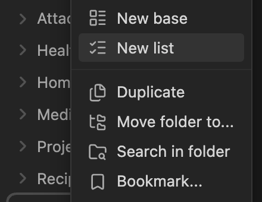
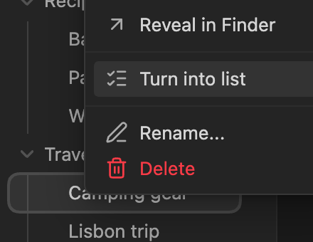
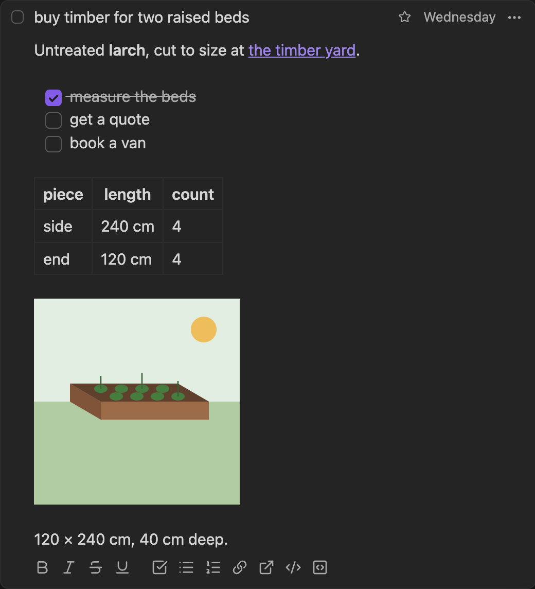
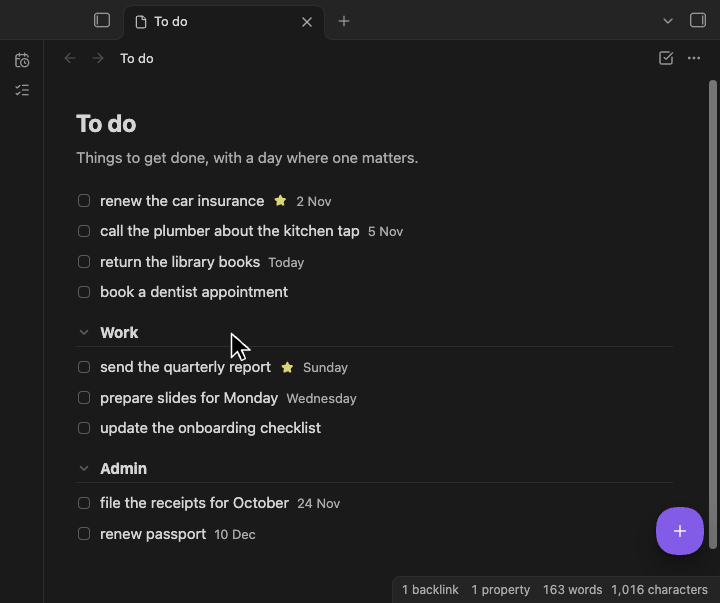
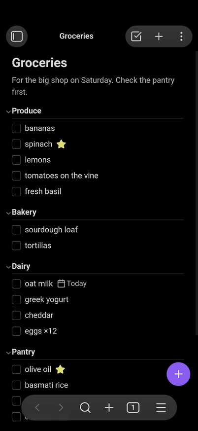

<h1 align="center">PrinceLists</h1>

<p align="center"><b>Todo lists for Obsidian, kept as plain Markdown notes.</b></p>

PrinceLists turns a note into a todo list, and a Schedule view shows what's coming up across all your lists. It's simple to use, and powerful when you need it.



Make a list from the ribbon, a folder, or a note you already have.

| Click the list icon in the ribbon | Right-click a folder in the sidebar | Right-click a note to turn it into a list |
| --- | --- | --- |
|  |  |  |

Ticked items hide after a day, or the time you choose in the settings. The filter icon finds items by their text, and can bring the hidden ones back, with blue checkboxes.


Each item has a title, a date, a star and powerful notes, with a toolbar for formatting.



The Schedule shows the dated items from all your lists.



It works great on your phone too.



You can embed lists in normal notes.

````markdown
```princelists
[[Hardware store]]
```
````


## Full feature list

**Lists**

- **Any note can be a list:** make a new one, in a folder you choose in the settings if you like, or turn a note with checkboxes into one.
- **Back to Markdown** any time with **Open as Markdown**, or for good with **Turn into note**.
- **Sections** come from headings. Drag them, collapse one, or collapse them all.
- **A note for the list** sits under its title.

**Items**

- **Add** with the floating **+**, and **drag** to reorder. The settings can put a **+** in the list's header instead, or as well, on desktop, mobile or both.
- **Star** an item and give it a date.
- **Tick and forget:** ticked items hide after a day, or after a time you choose, from at once to a week.
- **Find:** the filter icon in a list's header opens a field that filters it by title and notes, matching the letters you type in order, so "mlk" finds "oat milk", and by date as written, such as "2026-11". Toggles beside it show only starred items, or archived items too. The field stays open until the icon or Escape closes it. The Schedule has one beside its title, with the starred toggle.
- **Delete** with Undo.

**Notes on an item**

- **Edited like a note:** Markdown shows only where the cursor is, as in Obsidian's Live Preview. The list's own note edits the same way.
- **Any Markdown:** links, checklists, tables and code.
- **A toolbar** for bold, italic, links, lists, code blocks and more.
- **Paste from the web:** copied web pages and rich text paste as Markdown. Markdown copied from Obsidian pastes as it is.
- **Pictures:** paste or drop them in. On iOS, a picture dropped from Photos may not reach Obsidian; paste it instead.

**Across lists**

- **The Schedule,** in the right sidebar, sorts dated items into Today (with anything overdue), Tomorrow, Next 7 days and Later. The ribbon icon opens it, and a setting adds a button for it to each list's header. Closed its tab? The ribbon icon or PrinceLists' settings bring it back.
- **A list inside another note** can be ticked and edited there. If you rename the list, update the block.
- **Works with Tasks:** dates use the Tasks plugin's format.

**Keys and devices**

- **Shortcuts:** Cmd+Enter adds an item, Cmd+F filters a list or the Schedule, Cmd+Shift+A shows or hides archived items, Cmd+Z undoes, and Cmd+B, Cmd+I and Cmd+K format. Use Ctrl on Windows and Linux.
- **Right-click menus** on items, headings, pictures and the list. On desktop, text in a card or the list's note gets a menu too: add a link, format, and paste with or without formatting.
- **Made for touch:** a floating **+**, finger-sized buttons, and hold to drag.
- **Fits your theme,** light or dark.

## Quick start

1. **Install** PrinceLists from Settings → Community plugins → Browse, and enable it. It's [listed in Obsidian's community directory](https://community.obsidian.md/plugins/princelists).
2. **Make a list** with the list icon in the ribbon, or right-click a folder and choose **New list**.
3. **Add items** with the **+**. Click one to add notes, a star or a date.

Already have a note with checkboxes? Right-click it and choose **Turn into list**. Items already ticked hide at once, and **Show archived items** shows them.

<details>
<summary>Install by hand instead</summary>

1. Download `main.js`, `manifest.json` and `styles.css` from the [latest release](https://github.com/princelundgren/PrinceListsObsidianPlugin/releases/latest).
2. Put them in `<vault>/.obsidian/plugins/princelists/`, where `<vault>` is your vault's folder.
3. In Settings → Community plugins, turn on community plugins if Restricted mode is on, and enable PrinceLists under Installed plugins.

</details>

## How a list is stored

```markdown
---
princelists: true
---
Stuff for the new apartment.

## Kitchen
- [ ] cutting board
- [ ] freezer storage boxes ⏳ 2026-10-21 📅 2026-10-30

	Buy 6:
	- one for the freezer
	- five for the pantry
- [x] glass jars 1 l ✔ 2026-10-20 23:55
```

- **`princelists: true`** makes a note a list.
- **Headings** are sections, **checkboxes** are items, and lines indented under an item are its notes.
- **An item's date** is the [Tasks](https://github.com/obsidian-tasks-group/obsidian-tasks) plugin's scheduled date, ⏳. Other Tasks fields, such as 📅, stay as they are.
- **`✔` with a time** marks when you ticked an item. Tasks still sees it as done.
- **Only the lines you edit change.** The rest of the note stays as you wrote it.

The full format is in the [design](docs/superpowers/specs/2026-10-20-prince-lists-design.md#file-format).

## Good to know

- **Private:** PrinceLists works only on notes Obsidian opens: your vault's, and on desktop a note you open from outside it. No network requests of its own, no data collected, no account. A picture linked from the web loads as in any note. What Obsidian's plugin directory notes:
  - **Vault enumeration:** to find your lists, the Schedule goes through your vault's list of notes, and reads only the lists.
  - **Clipboard access:** only when you ask. Copy image, Copy text, Cut and Copy write to it. Paste and Paste as plain text in the right-click menu read it, and what you paste with Cmd+V is read from your paste. PrinceLists never reads the clipboard by itself.
- **Obsidian Sync:** turn on Sync's "Active community plugin list" and "Installed community plugin list" to get PrinceLists on your other devices. If two devices edit a list within seconds, Sync can drop one change, as in any note. Sync's "Create conflict file" setting keeps both, as extra lists.
- **Made for** Obsidian on macOS, iOS, Android and Windows. If something looks wrong, [open an issue](https://github.com/princelundgren/PrinceListsObsidianPlugin/issues).

## Contributing

Bug reports, ideas and pull requests are welcome.

- Start with [CONTRIBUTING.md](CONTRIBUTING.md) and the [rules in AGENTS.md](AGENTS.md#rules-that-are-never-broken).
- Be kind: see the [code of conduct](CODE_OF_CONDUCT.md).
- The designs for [step one](docs/superpowers/specs/2026-10-20-prince-lists-design.md) and [step two](docs/superpowers/specs/2026-10-27-prince-lists-step-2-design.md) say what the plugin does and why.
- To report a security problem, see [SECURITY.md](SECURITY.md).

## License

[MIT](LICENSE). The built `main.js` includes commonmark.js, entities, mdurl, `@codemirror/lang-markdown` and `@lezer/markdown`, under their own licenses: see [THIRD_PARTY_NOTICES](THIRD_PARTY_NOTICES).
