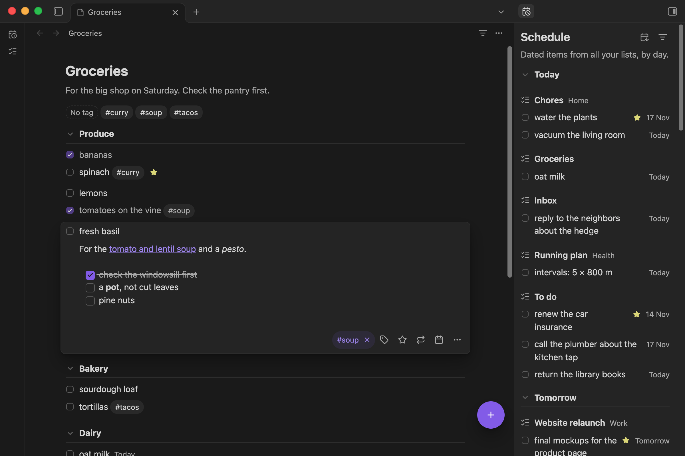
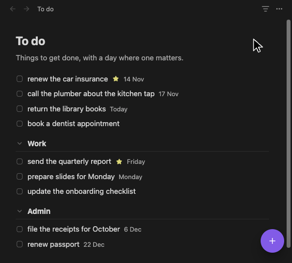
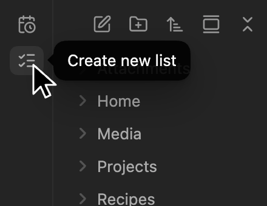
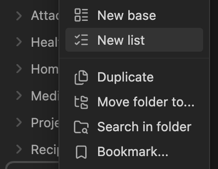
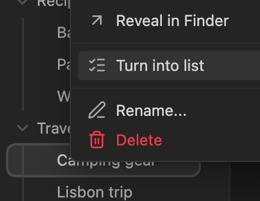
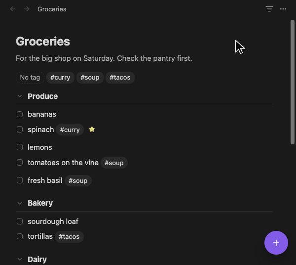
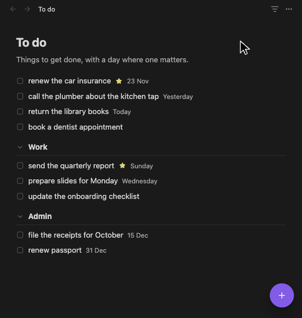
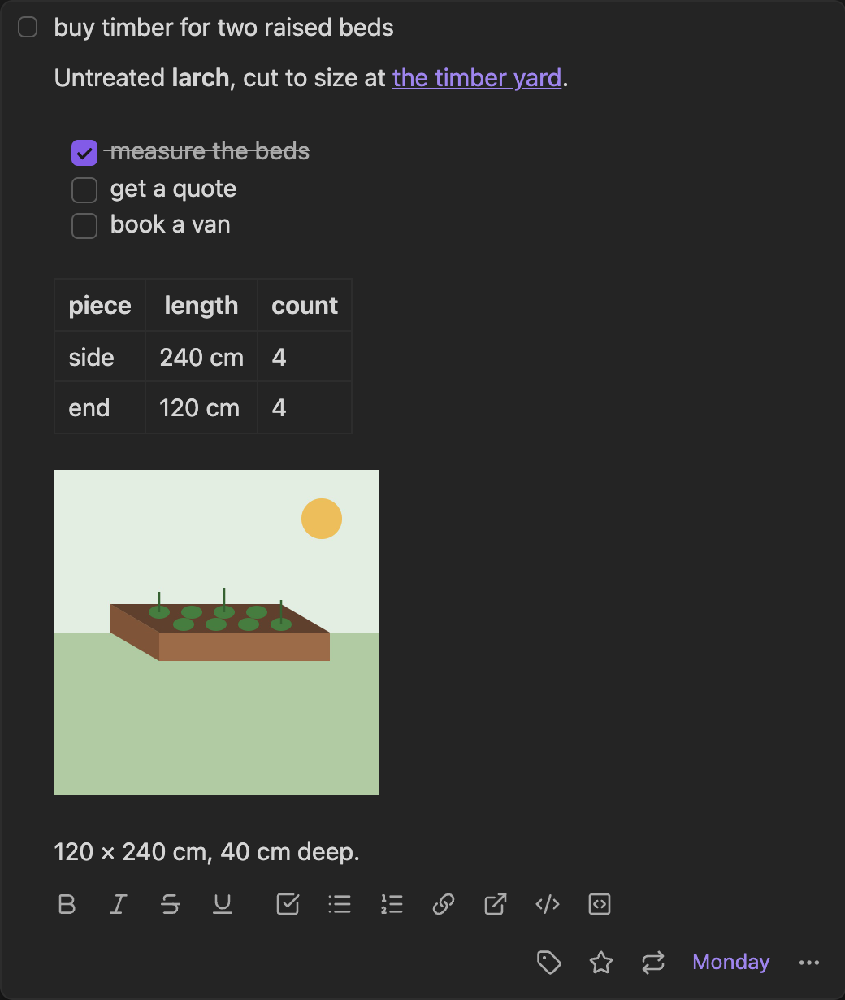
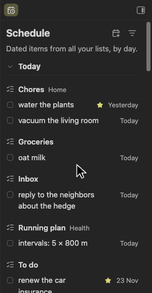
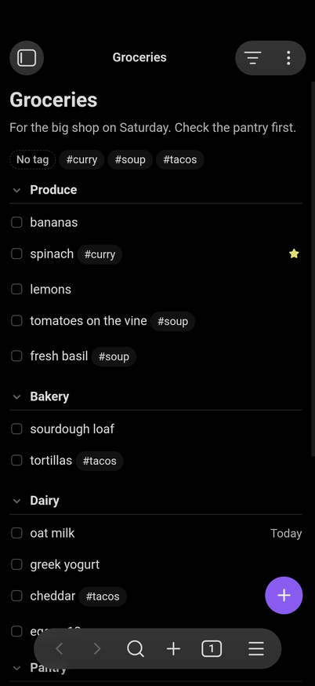

<h1 align="center">PrinceLists</h1>

<p align="center"><b>Todo lists for Obsidian, kept as plain Markdown notes.</b></p>



PrinceLists turns a note into a todo list, and the Schedule shows what's coming up across all your lists.

## A quick tour

### Lists

Tick, drag and add items right where they go.



### Make a list

From the ribbon, a folder, or a note you already have.

| Click the list icon in the ribbon | Right-click a folder in the sidebar | Right-click a note to turn it into a list |
| --- | --- | --- |
|  |  |  |

### Find

Filter a list by text, and bring back ticked items.


### Tags

Tag items, then click a tag to see only those.



### Select several

Hold an item, add others, and act on them all at once.



### Notes

Every item has notes, with full Markdown and a toolbar.



### Schedule

Dated items from all your lists, in one sidebar.



### On your phone

Made for touch, with the same lists.



### Lists inside notes

Embed a list in any note, and tick it there.

````markdown
```princelists
[[Hardware store]]
```
````


### Make it yours

Pick colors for overdue, today's and upcoming dates and for the star, and see them in the settings' preview as you go.


## Full feature list

**Lists**

- **Any note can be a list:** make one, or turn a note with checkboxes into one.
- **Back to Markdown** with **Open as Markdown**, or for good with **Turn into note**.
- **Sections** come from headings: drag them, or collapse one or all.
- **A note for the list** sits under its title.

**Items**

- **Add** with the floating **+**, or drag the **+** to where the item goes.
- **Drag** to reorder.
- **Star** an item and give it a date. Once the date has passed, an item you haven't ticked shows it's late.
- **Repeat** every few days, weeks, months or years; a ticked item comes back open once its date has come and you next open its list or the Schedule.
- **Tags** on an item, from its card or right-click menu; a tag in a heading (`## Office #work`) counts for its section, and one in the list's `tags` property for every item.
- **Select several** by holding an item, or with Cmd+click and Shift+click, to move, date, tick, tag, star, duplicate or delete them at once.
- **Tick and forget:** ticked items hide after a day, or the time you choose.
- **Find** items by title, notes or date, with the words it finds colored, and show only starred items, or archived ones too.
- **Filter by tag** from the strip above the list, or show the items with **No tag**.
- **Duplicate** an item with its notes.
- **Delete** with Undo.

**Notes on an item**

- **Edited like a note,** with Markdown shown only where the cursor is.
- **Any Markdown:** links, checklists, tables and code, with a toolbar.
- **Paste from the web** as Markdown.
- **Pictures:** paste or drop them in.

**Across lists**

- **The Schedule** shows dated items by day and by list, or in date order with **Sort by date**. Overdue items sit under Today and show they're late. The ribbon icon opens it.
- **A list inside another note** can be ticked and edited there.
- **Works with Tasks:** dates use the Tasks plugin's format.

**Keys and devices**

- **Shortcuts:** Cmd+Enter adds an item, Cmd+F filters, Cmd+Shift+A shows or hides archived items, Cmd+Z undoes. Use Ctrl on Windows and Linux.
- **Right-click menus** on items, headings, pictures and the list.
- **Made for touch:** finger-sized buttons, and hold to select or drag.
- **Fits your theme,** light or dark.
- **Settings,** in Lists, Schedule and Appearance sections, with a preview of the colors: a folder for new lists, when ticked items hide, what an overdue item's date says and its color, the colors of today's and upcoming dates, the star's color, the tag strip, where the floating **+** shows, a Schedule button in each list's header, and the Schedule back in the sidebar if you closed it.

## Quick start

1. **Install** PrinceLists from Settings → Community plugins → Browse, and enable it. It's [listed in Obsidian's community directory](https://community.obsidian.md/plugins/princelists).
2. **Make a list** with the list icon in the ribbon, or right-click a folder and choose **New list**.
3. **Add items** with the **+**. Click one to add notes, a star or a date.

Already have a note with checkboxes? Right-click it and choose **Turn into list**. Items already ticked hide at once, and **Show archived items** shows them.

<details>
<summary>Install by hand instead</summary>

1. Download `main.js`, `manifest.json` and `styles.css` from the [latest release](https://github.com/princelundgren/PrinceListsObsidianPlugin/releases/latest).
2. Put them in `<vault>/.obsidian/plugins/princelists/`, where `<vault>` is your vault's folder.
3. In Settings → Community plugins, turn on community plugins if Restricted mode is on, and enable PrinceLists under Installed plugins.

</details>

## How a list is stored

```markdown
---
princelists: true
---
Stuff for the new apartment.

## Kitchen
- [ ] cutting board
- [ ] freezer storage boxes ⏳ 2026-10-21 📅 2026-10-30

	Buy 6:
	- one for the freezer
	- five for the pantry
- [x] glass jars 1 l ✔ 2026-10-20 23:55
```

- **`princelists: true`** makes a note a list.
- **`tags`** is the list's tags, as in `tags: [home, errands]`, set with **Tag list…** in the list's menu, in Obsidian's file properties sidebar (**Show file properties**) while the list is open, or with **Edit in Markdown**. Write the tags without a `#`, or quote it: an unquoted `tags: #home` is a YAML comment and gives the list no tag. Every item counts them.
- **Headings** are sections, **checkboxes** are items, and lines indented under an item are its notes.
- **An item's date** is the [Tasks](https://github.com/obsidian-tasks-group/obsidian-tasks) plugin's scheduled date, ⏳. Other Tasks fields, such as 📅, stay as they are, except that a repeating item's 📅 and 🛫 move with its ⏳ when it comes back. Only the ⏳ date makes an item overdue, not 📅.
- **`✔` with a time** marks when you ticked an item. Tasks still sees it as done.
- **Only the lines you edit change.** The rest of the note stays as you wrote it. The one exception is a repeating item coming back, which changes its own line and unticks the checklist in its notes.

The full format is in the [design](docs/superpowers/specs/2026-10-20-prince-lists-design.md#file-format).

## Good to know

- **Private:** PrinceLists works only on notes Obsidian opens: your vault's, and on desktop a note you open from outside it. No network requests of its own, no data collected, no account. A picture linked from the web loads as in any note. What Obsidian's plugin directory notes:
  - **Vault enumeration:** to find your lists, the Schedule goes through your vault's list of notes, and reads only the lists.
  - **Clipboard access:** only when you ask. Copy image, Copy text, Cut and Copy write to it. Paste and Paste as plain text in the right-click menu read it, and what you paste with Cmd+V is read from your paste. PrinceLists never reads the clipboard by itself.
- **Obsidian Sync:** turn on Sync's "Active community plugin list" and "Installed community plugin list" to get PrinceLists on your other devices. If two devices edit a list within seconds, Sync can drop one change, as in any note. Sync's "Create conflict file" setting keeps both, as extra lists.
- **A repeating item** stays ticked in the file until it comes back, so until then Tasks queries and other apps show it done.
- **Renamed a list?** Update the blocks that show it in other notes.
- **On iOS,** a picture dropped from Photos may not reach Obsidian; paste it instead.
- **Made for** Obsidian on macOS, iOS, Android and Windows. If something looks wrong, [open an issue](https://github.com/princelundgren/PrinceListsObsidianPlugin/issues).

## Contributing

Bug reports, ideas and pull requests are welcome.

- Start with [CONTRIBUTING.md](CONTRIBUTING.md) and the [rules in AGENTS.md](AGENTS.md#rules-that-are-never-broken).
- Be kind: see the [code of conduct](CODE_OF_CONDUCT.md).
- The designs listed in [AGENTS.md](AGENTS.md#project-overview) say what the plugin does and why.
- To report a security problem, see [SECURITY.md](SECURITY.md).

## License

[MIT](LICENSE). The built `main.js` includes commonmark.js, entities, mdurl, `@codemirror/lang-markdown` and `@lezer/markdown`, and adapts the Tasks plugin's field patterns, under their own licenses: see [THIRD_PARTY_NOTICES](THIRD_PARTY_NOTICES).
